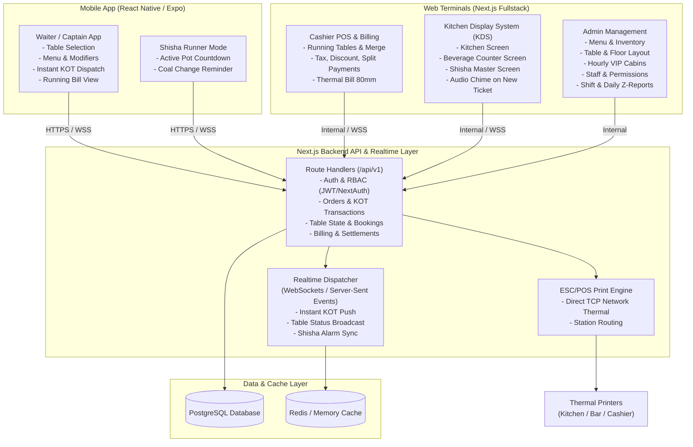

# Layali Restaurant & Lounge POS + KOT System
## Comprehensive Project Analysis & End-to-End Implementation Blueprint

---

### Executive Summary
**Layali** is a specialized, luxury lounge and restaurant management platform combining traditional restaurant POS capabilities with lounge-specific operations (multi-station Kitchen Order Tickets, live Shisha coal/pot timers, and hourly private cabin/VIP room bookings).

The current workspace contains a high-quality frontend prototype (`layali-kot-&-restaurant-pos`) built with **React 19 + Vite + Tailwind CSS v4**. While the UI and client domain modeling are solid, it currently runs exclusively in the browser using `localStorage`.

To make this a **production-grade, multi-terminal, live restaurant system**, we will implement:
1. **Next.js Fullstack Platform** (`apps/web` or `layali-web`):
   - Web POS & Cashier Station (Billing, Split Payments, Thermal Printouts, Cash Register Reconciliation).
   - Kitchen Display System (KDS) & Bar/Shisha screens (touch-friendly, multi-station, sound alerts).
   - Admin & Operations Portal (Menu & Price management, Table layout, Hourly VIP Cabins, Inventory, Staff roles, Shift & Sales reports).
   - Central Backend Engine (REST + WebSocket/SSE API endpoints) serving both web terminals and mobile apps.
2. **React Native Mobile App** (`apps/mobile` or `layali-mobile`):
   - Waiter & Floor Captain mobile ordering terminal (quick table selection, category filter, instant item punch, modifiers/custom notes, KOT dispatch, running table bill).
   - Shisha Master / Runner companion mode (table-side coal alerts, duration extension).
   - Bluetooth / Wi-Fi thermal printer support.
3. **Database & Realtime Sync Engine**:
   - PostgreSQL with Prisma ORM / Drizzle ORM.
   - Low-latency real-time synchronization (WebSockets or Server-Sent Events with Pub/Sub).

---

## 1. Current Project Analysis

### 1.1 Existing Strengths
- **Rich Domain Specialization**: Already models lounge-specific flows that off-the-shelf restaurant systems lack:
  - Shisha pot duration timers (countdown from 45 min, coal change urgency alerts).
  - Private VIP Lounge / Couple Cabin bookings with hourly rates and advance deposits.
  - Multi-station KOT routing (`Kitchen`, `Beverage Counter`, `Shisha Master`).
  - Thermal receipt formatting for 80mm / 58mm printers.
- **Design Aesthetic**: Premium dark lounge atmosphere (`#12141d` dark slate, `#9f1119` deep crimson, `#d4af37` gold highlights), tailored for nightlife / lounge environments.
- **Sound Alert Engine**: Built-in chime & urgency alert tones for kitchen and shisha timers.

### 1.2 Critical Gaps to Solve for Production
| Dimension | Current Prototype | Production Requirement |
| :--- | :--- | :--- |
| **State & Persistence** | Browser `localStorage` (single tab only) | Centralized Relational DB (PostgreSQL), transactional ACID guarantees |
| **Multi-Terminal Sync** | None (orders on one phone don't appear in kitchen) | Sub-second real-time sync (WebSockets / SSE) across Waiter mobile, Cashier, Kitchen, and Shisha stations |
| **User & Role Access** | Single hardcoded "Manager" / "Captain" string | Role-Based Access Control (RBAC): `ADMIN`, `CASHIER`, `CAPTAIN`, `KITCHEN_CHEF`, `SHISHA_MASTER` |
| **Hardware & Printing** | Browser `window.print()` popup | ESC/POS silent network printing for kitchen printers (TCP 9100) + Bluetooth thermal printing from mobile |
| **Order Lifecycle** | Basic NEW -> PREPARING -> READY -> SERVED | Running KOT incremental tokens (KOT #1, KOT #2 on Table 4), item voiding with supervisor PIN, table transfers & bill merging |
| **Shift / Cash Management** | None | Shift opening float, cash drops, Z-Report day-end register reconciliation |

---

## 2. End-to-End System Architecture



---

## 3. Database Schema Design (Prisma / PostgreSQL)

```prisma
// Core Entities
enum Role {
  ADMIN
  MANAGER
  CASHIER
  CAPTAIN
  KITCHEN_CHEF
  SHISHA_MASTER
}

enum TableStatus {
  VACANT
  OCCUPIED
  BILL_PRINTED
  RESERVED
}

enum Station {
  KITCHEN
  BEVERAGE_COUNTER
  SHISHA_MASTER
}

enum KOTStatus {
  NEW
  PREPARING
  READY
  SERVED
  CANCELLED
}

enum OrderStatus {
  OPEN
  SETTLED
  VOIDED
}

enum PaymentMethod {
  CASH
  UPI
  CARD
  CREDIT_ACCOUNT
  SPLIT
}

model User {
  id           String    @id @default(cuid())
  name         String
  pin          String    // 4-digit quick PIN for POS tablet / mobile
  role         Role
  phone        String?   @unique
  isActive     Boolean   @default(true)
  orders       Order[]
  createdKOTs  KOT[]
  createdAt    DateTime  @default(now())
}

model Table {
  id           String       @id @default(cuid())
  name         String       // "Table 1", "VIP Lounge"
  floor        String       // "Main Floor", "1st Floor", "Rooftop"
  capacity     Int          @default(4)
  isPrivate    Boolean      @default(false)
  hourlyRate   Decimal?     @default(0)
  status       TableStatus  @default(VACANT)
  activeOrder  Order?       @relation("ActiveTableOrder")
}

model Category {
  id           String       @id @default(cuid())
  name         String
  station      Station      @default(KITCHEN)
  sortOrder    Int          @default(0)
  items        MenuItem[]
}

model MenuItem {
  id           String       @id @default(cuid())
  name         String
  categoryId   String
  category     Category     @relation(fields: [categoryId], references: [id])
  price        Decimal
  station      Station
  isAvailable  Boolean      @default(true)
  prepTimeMin  Int          @default(15)
  orderItems   OrderItem[]
}

model Order {
  id             String         @id @default(cuid())
  orderNumber    String         @unique // "LY-1001"
  tableId        String?        @unique
  table          Table?         @relation("ActiveTableOrder", fields: [tableId], references: [id])
  tableName      String         // Snapshot of table name
  guestName      String?
  guestPhone     String?
  staffId        String
  staff          User           @relation(fields: [staffId], references: [id])
  bookingId      String?
  booking        PrivateBooking? @relation(fields: [bookingId], references: [id])
  status         OrderStatus    @default(OPEN)
  notes          String?
  shishaAdvance  Decimal        @default(0)
  discountAmount Decimal        @default(0)
  taxPercent     Decimal        @default(5.0)
  items          OrderItem[]
  kots           KOT[]
  payments       Payment[]
  createdAt      DateTime       @default(now())
  updatedAt      DateTime       @updatedAt
  closedAt       DateTime?
}

model OrderItem {
  id          String    @id @default(cuid())
  orderId     String
  order       Order     @relation(fields: [orderId], references: [id])
  menuItemId  String
  menuItem    MenuItem  @relation(fields: [menuItemId], references: [id])
  name        String
  price       Decimal
  qty         Int
  station     Station
  notes       String?   // "Extra crispy", "Less ice"
  kotId       String?
  kot         KOT?      @relation(fields: [kotId], references: [id])
}

model KOT {
  id             String       @id @default(cuid())
  kotNumber      String       // "KOT-0012"
  orderId        String
  order          Order        @relation(fields: [orderId], references: [id])
  station        Station
  status         KOTStatus    @default(NEW)
  notes          String?
  durationMin    Int?         // for Shisha timers (e.g., 45 mins)
  createdById    String
  createdBy      User         @relation(fields: [createdById], references: [id])
  items          OrderItem[]
  createdAt      DateTime     @default(now())
  startedAt      DateTime?
  readyAt        DateTime?
  servedAt       DateTime?
}

model PrivateBooking {
  id           String     @id @default(cuid())
  bookingNumber String    @unique // "BK-101"
  venue        String     // "VIP Lounge", "Couple Cabin"
  guest        String
  phone        String
  ratePerHour  Decimal
  advancePaid  Decimal
  hours        Decimal
  notes        String?
  status       String     // "ACTIVE", "CLOSED"
  startTime    DateTime   @default(now())
  endTime      DateTime?
  orders       Order[]
}

model Payment {
  id           String         @id @default(cuid())
  orderId      String
  order        Order          @relation(fields: [orderId], references: [id])
  amount       Decimal
  method       PaymentMethod
  reference    String?        // UPI ref / Card last 4 / Khata note
  recordedBy   String
  createdAt    DateTime       @default(now())
}

model ShiftRegister {
  id           String     @id @default(cuid())
  openedBy     String
  openingFloat Decimal
  closedBy     String?
  closingCash  Decimal?
  expectedCash Decimal?
  totalUpi     Decimal    @default(0)
  totalCard    Decimal    @default(0)
  totalCredit  Decimal    @default(0)
  startedAt    DateTime   @default(now())
  closedAt     DateTime?
}
```

---

## 4. Feature Specifications by Module

### 4.1 Next.js Fullstack Web Application
1. **Cashier POS & Floor Manager**:
   - Visual floor plan with real-time status (Vacant in Green, Occupied in Red, Bill Printed in Amber).
   - Instant order review, split item billing, multi-tender payments (e.g. ₹500 Cash + ₹700 UPI).
   - 80mm ESC/POS Thermal Bill generator with QR code for UPI scanning (Dynamic UPI BharatQR format: `upi://pay?pa=...&pn=Layali&am=...`).
2. **Multi-Station Kitchen Display System (KDS)**:
   - Dedicated full-screen views for:
     - **Main Kitchen Screen** (Chef view: filter burgers, rice, pasta, starters).
     - **Beverage Counter Screen** (Bartender/Barista view: mojitos, shakes, sodas).
     - **Shisha Master Screen** (Pots in prep, base mixes, active table sessions).
   - Color-coded tickets with aging badges (Green: < 10m, Orange: 10-20m, Red blinking: > 20m).
   - Audio chime upon incoming KOT.
3. **Shisha Session Live Dashboard**:
   - Table-wise countdown timers.
   - Alert notifications: Coal check needed (at 20m), Coal refill, Session expiry.
   - 1-click +15m / +30m extension with automatic price recalculation.
4. **VIP Cabin & Private Lounge Booking Manager**:
   - Hourly calculation with automatic overtime prorating.
   - Advance deposit reconciliation against final restaurant food & beverage bill.
5. **Admin & Reporting**:
   - Menu pricing & instant "Out of Stock" switch.
   - Daily Sales, Category Sales, Hourly Peak charts, Waiter performance, Shisha flavor rankings.
   - Day-End Cash Register (Z-Report) generator.

### 4.2 React Native Mobile App (Waiter / Captain)
1. **Quick-Turnaround Waiter UX**:
   - 4-digit PIN quick lock/unlock for fast table switching.
   - Floor / Table selector with instant visual occupancy indication.
   - One-thumb category scrolling and instant item search.
   - Item modifiers modal (e.g. "Afzal Mix" -> prompt base option: "Mint Mojito Base", "Milk Base", or "Normal Chilled").
   - Kitchen notes quick-pills ("Less Spicy", "No Onion", "Serve First").
2. **One-Tap KOT Dispatch**:
   - Direct punching generates station KOTs instantly across the network.
   - Running table bill allows adding additional rounds (Rounds 2, 3...) seamlessly without overwriting past rounds.
3. **Runner / Shisha Notifications**:
   - Vibrations and push notification when Shisha coals need replenishment.
   - Notification when Kitchen Chef marks KOT "Ready for Pickup".
4. **Offline Resilience**:
   - Local cart cache in SQLite/AsyncStorage: if lounge Wi-Fi flickers, the order is queued and synced the moment connection recovers.

---

## 5. Migration & Project Workspace Strategy

To give you the cleanest architecture, we organize the repository into 2 dedicated modular root directories:

```
layali/
├── web/                        # Next.js 16 Fullstack App (Web POS, KDS, Cashier, Admin & MongoDB Atlas API)
│   ├── src/
│   │   ├── app/                # App Router pages & REST/SSE APIs (/api/v1/...)
│   │   ├── components/         # Modular Views (TopBar, NavTabs, POS, KDS, Shisha, Cashier, Bookings, ThermalReceipt)
│   │   ├── models/             # Mongoose models with high-speed compound indexes
│   │   ├── lib/                # MongoDB connection pooling & Realtime SSE Dispatcher
│   │   └── utils/              # Audio alert synthesis & Currency/Date formatters
│   ├── .env.example            # MongoDB Atlas URI configuration
│   └── package.json
│
├── mobile/                     # React Native (Expo) Waiter / Captain Mobile POS
│   ├── src/
│   │   ├── constants/          # Colors, theme, spacing
│   │   ├── types/              # Mobile TypeScript interfaces
│   │   ├── services/           # API client communicating with Next.js backend
│   │   ├── context/            # POSContext global state & actions
│   │   ├── components/         # Modular Components (Header, BottomNav, TableCard, MenuItemCard, StickyCartBar, KOTCard, ShishaCard, Modals)
│   │   └── screens/            # Modular Screens (TablesScreen, OrderScreen, KOTsScreen, ShishaScreen)
│   ├── App.tsx                 # Clean entry point wrapped in POSProvider
│   └── package.json
│
├── plan/                       # Master Architecture Blueprint & Domain Specifications
└── layali-kot-&-restaurant-pos/# Original prototype reference
```

---

## 6. Phased Execution Roadmap

### Phase 1: Next.js Fullstack Scaffold & Database Setup
- Initialize Next.js 15 (App Router, TypeScript, Tailwind CSS, Lucide).
- Set up Prisma ORM with the complete PostgreSQL/SQLite schema (Tables, Menu, Orders, KOTs, Payments, Bookings).
- Seed the database with the complete Layali menu items, stations, and initial tables.

### Phase 2: Central API & Realtime Communication Hub
- Build API route handlers:
  - Auth: PIN-based staff login & token issuing.
  - Table & Order management: Open order, add items, compute bill, transfer tables.
  - KOT dispatch: Automated splitting by station (`Kitchen`, `Beverage`, `Shisha`).
  - Shisha timers: Start, extend, pause, and mark served.
  - Billing & Settlements: Cash, UPI, Card, Discount, Split.
- Set up Realtime synchronization (SSE / WebSockets) for instant multi-screen updates.

### Phase 3: Web Application (POS, KDS, Cashier & Admin)
- Port and elevate existing UI components (`POSOrderView`, `KOTQueueView`, `ShishaTimerView`, `BillingView`, `PrivateBookingsView`) into Next.js App Router with live database & realtime bindings.
- Build dedicated touch KDS screen modes with audible notification bells.
- Implement ESC/POS thermal receipt formatting and UPI QR generation.

### Phase 4: React Native Mobile App (Waiter / Captain POS)
- Scaffold Expo React Native app with TypeScript.
- Implement floor/table grid screen with instant color-coded states.
- Implement speed-optimized mobile ordering cart with instant modifier selection.
- Implement live KOT dispatch and running table view.
- Add sound & vibration feedback for orders and shisha coal alerts.

### Phase 5: Hardware & End-to-End Validation
- Multi-device testing: Waiter phone punches order -> KDS chimes immediately -> Cashier views running total -> Bill prints.
- Stress testing, offline reconnection handling, and role permission verifications.
